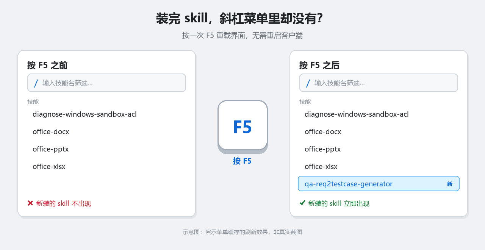

# dsh-quick-reload

[](https://github.com/devthires/dsh-quick-reload/releases)
[](LICENSE)

把 **F5** 绑定为刷新 DeepSeek Harness（DSH）Web 客户端，让**新装的 skill 和插件无需重启客户端**即可生效。



> 示意图：演示斜杠菜单缓存的刷新效果，非真实截图。

## 要解决的问题

安装 skill 后，文件已经落盘、Host 侧也立刻识别了 —— 但 `/` 斜杠菜单在整个页面生命周期内都使用**缓存的技能目录**。这份缓存只在切换 agent preset 或连接重置时才失效，所以刚装好的 skill 在菜单里看不到，必须重启整个客户端。

DSH Desktop 本身也没有内置刷新快捷键：外壳没有绑定任何刷新加速键（只绑了 <kbd>F12</kbd> 开 DevTools），浏览器式的刷新也没有接上。结果是输入 `/技能名` 也搜不到 —— 因为菜单是在那份旧缓存里做过滤的。

## 作用

按 <kbd>F5</kbd> 重载渲染层，客户端会重建并重新拉取目录 —— 新 skill 立即出现。


只接管**普通 F5**。带修饰键的（<kbd>Ctrl</kbd>+<kbd>F5</kbd>、<kbd>Shift</kbd>+<kbd>F5</kbd> 等）**故意不管**，按住不放也不会连续刷新。

## 环境要求

- 支持 profile 插件的 DSH Desktop。
- 开发与验证环境：`dsh` 0.1.5-rc.1、`@deepseek-ai` 包 0.2.0-rc.2、Windows 11。

## 安装

### DSH Desktop

打开 **设置 → 插件 → 添加插件**，填入仓库地址：

```
https://github.com/devthires/dsh-quick-reload
```

或填入本地克隆后的目录路径。

> `dsh plugin` CLI 会拒绝 `desktop` profile（提示 `profile "desktop" is managed exclusively by the Electron application`），所以在桌面端请用设置页安装。

### 自定义 profile 或 `web` profile

```bash
dsh plugin --profile web add github:devthires/dsh-quick-reload
```

## 使用

在窗口任意位置按 <kbd>F5</kbd>。

安装 skill 后按一次即可，不必再重启客户端。

## 卸载

在 **设置 → 插件** 中移除该插件，快捷键随之消失。

## 实现说明

这是一个标准的 DSH bundle，包含两个半身：

| 文件 | 作用 |
|---|---|
| `index.js` | Host 半身，空实现（该功能完全在客户端） |
| `client.js` | 客户端半身，注册 F5 监听 |
| `cordis.patch.yml` | 挂载声明，一行 `insert` |

客户端半身通过 `ctx.effect` 注册监听，因此 cordis 会在插件卸载时自动清理，不会残留事件。监听使用**捕获阶段**，所以在输入框、终端或弹窗持有焦点时同样生效。

> 包名、patch 行名、客户端模块 id 三者必须一致，此处均为 `dsh-quick-reload`。

## 重新生成演示图

演示图由脚本生成，需要 Pillow 与中文字体（Windows 自带微软雅黑）：

```bash
python tools/make_demo.py
```

## 许可

[MIT](LICENSE)
